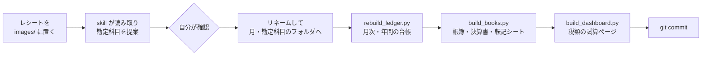

# 経費の仕分けと帳簿を Claude Code で回すサンプル

個人事業主の青色申告で、レシートの仕分けから帳簿・決算書の数字、税額の試算までを
Claude Code の skill と Python スクリプトで回す仕組みのサンプルです。

**取引先・店・金額などのデータは、すべて架空のダミーです。**

> [!WARNING]
> 税務の助言ではありません。無保証です。税率や控除額は令和8年分の前提で書いてあります。
> 自分の申告に使うときは、その年分の国税庁の資料で必ず確かめてください。申告の責任は納税者にあります。
> 個別の税務相談には応じられません。判断に迷うことは税理士や税務署に相談してください。

## 仕組み



- **ファイル名が明細**: `YYYYMMDD_取引先_金額.拡張子` を勘定科目のフォルダに置く。CSV は集計だけを持つ
- **数字はスクリプトが作る**: AI は読み取り・提案・ファイルの移動まで。集計は毎回書き直させない
- **読めないものがあれば止まる**: 1件でも日付・金額を読めない・貸借が合わないときは、何も書かずに中止する
- **消さない**: 重複は `_重複` を付けて残し、訂正は `訂正削除履歴.csv` と git の履歴に残す

## 試す

必要なもの: Python 3.9 以上（標準ライブラリだけ。追加のインストールなし）、Claude Code

```bash
python3 scripts/rebuild_ledger.py 2026    # 管理台帳（月次・年間）
python3 scripts/build_books.py 2026       # 仕訳帳・総勘定元帳・決算書・転記シート・帳簿.html
python3 scripts/build_dashboard.py        # dashboard.html（税額の試算）
```

生成済みの `帳簿.html` と `dashboard.html` が入っているので、ブラウザで開けばすぐ中身を見られます（データはダミー）。
上のスクリプトを実行すると作り直せます。

Claude Code では、`images/` にダミーのレシートが2枚あります。

```
claude
> /update-expenses
```

起動時に hook が「入金日が未確認の売上」「税制改正チェックが未実行」を知らせます
（ダミーの入金日は、8月度の1件をわざと空けてあります。日付が進むと、支払期限を過ぎた月度も加わります）。

## 構成

```
.
├── LICENSE
├── CLAUDE.md                  ルール（ファイル名・勘定科目・定期項目・訂正の記録・税制パラメータ）
├── 事務処理規程.md             電子帳簿保存法の事務処理規程の雛形
├── 帳簿.html                  仕訳帳・総勘定元帳・決算書・転記シート（build_books.py が生成）
├── dashboard.html             税額の試算（build_dashboard.py が生成）
├── 訂正削除履歴.csv
├── .claude/
│   ├── settings.json          許可と hook の設定
│   ├── skills/                仕分け・集計・検証・入金日・税制改正の skill（6つ）
│   └── hooks/                 起動時のリマインド・訂正の振り返り
├── scripts/
│   ├── rebuild_ledger.py      ファイル名から管理台帳を集計
│   ├── build_books.py         帳簿・決算書・転記シート・帳簿.html
│   ├── build_dashboard.py     税額の試算ページ
│   ├── check_receipt_dates.py 入金日が未確認の売上の一覧
│   └── tax_rules.py           速算表など（帳簿とダッシュボードで共通）
├── docs/                      帳簿システムの説明書・事業者の基本情報（雛形）
├── images/                    未仕分けのレシート置き場
├── 2024/ 2025/                申告済みの決算書（ダミー）
└── 2026/                      今年のレシート・売上・サマリー（ダミー）
```

## 自分用にするとき

このリポジトリを **Fork しない**でください。public のリポジトリの Fork は private にできないので、実物のレシートを push すると公開されてしまいます。
clone して、自分で新しく作った private のリポジトリに push します。

1. ダミーのデータを消す: `2024/` `2025/` `2026/`、`images/IMG_*.pdf`、`帳簿.html`、`dashboard.html`、`訂正削除履歴.csv` の例の行
2. 自分の内容に書き換える

   | ファイル | 直すところ |
   |---|---|
   | `CLAUDE.md` | 勘定科目の判断基準、領収書が発生しない定期項目の表 |
   | `docs/事業者の基本情報.md` | 業種・消費税の区分など（税制改正チェックの判定に使う） |
   | `事務処理規程.md` | 氏名・日付 |
   | `scripts/tax_rules.py` | `DEEMED_PURCHASE_RATE`（簡易課税のみなし仕入率） |
   | `scripts/build_books.py` | `DEPOSIT_ACCOUNT`（入金先の口座の扱い）、`FREE_ORDER`（決算書の空欄の順） |
   | `scripts/build_dashboard.py` | `CLIENT_END_MONTH`（終了が決まっている取引先）、`JUMIN`（住民税の前提） |
   | `scripts/check_receipt_dates.py` | `FIRST_YEAR`（入金日を記録し始めた年） |
   | `.claude/skills/recording-deposit-dates/SKILL.md` | 振込名義と取引先の対応表 |

3. 年の初めに CSV を用意する（形式は `2026/` のダミーと `docs/帳簿システムの説明書.md` を参照）
   - `YYYY/売上高_YYYY.csv`・`売上先一覧_YYYY.csv`・`確定申告サマリー_YYYY.csv`
     （サマリーの【地代家賃】【固定資産・減価償却】などは、使わない年も0の行を残す）
   - `YYYY/帳簿/期首残高_YYYY.csv`（前年の貸借対照表の期末）。期首に売掛金があるときは、前年の `売上高_YYYY.csv`（12月度）も要る
   - 前年までの決算書は `YYYY/帳簿/決算書_YYYY.csv` に転記する（出典欄を「申告済み」で始める）
   - 任意: `定期経費_YYYY.csv`・`寄付金/寄付金_YYYY.csv`・`帳簿/手入力仕訳_YYYY.csv`・`帳簿/入金日_YYYY.csv`
4. 自分のデータを入れたリポジトリは **private** にする。`帳簿.html`・`dashboard.html` も外に出さない

## 対応していないこと

- 消費税の本則課税・免税事業者（簡易課税だけ）
- 専従者給与（0円でないと中止する）
- 2件以上の償却資産
- 事業用の預金口座の出入りの記帳（`DEPOSIT_ACCOUNT` を普通預金にすれば入金は仕訳にするが、ほかの出入りは手入力仕訳で入れる）
- 優良な電子帳簿（75万円の青色申告特別控除）の要件
- 個人事業税

## 注意

- **紙のレシートは捨てない。** 画像は整理・検索用です。紙を捨てて画像だけにする（スキャナ保存）には、
  タイムスタンプなどの要件があり、この仕組みは満たしていません
- 申告書は、転記シートを見ながら国税庁の確定申告書等作成コーナーで自分で入力し、e-Tax で送ります
- AI の読み取りや税の説明は間違うことがあります。提案は必ず自分で確かめてから通してください
- ダミーデータの勘定科目の振り分けは、動作を見せるための例です。実際の判断基準ではありません
- 読ませたレシートの画像は Anthropic のサーバーに送られます。個人向けのプランなら、プライバシー設定でモデルの改善への利用をどうしているか、先に確かめてください（[データの扱い](https://code.claude.com/docs/en/data-usage)）

## ライセンス

[MIT License](LICENSE)
